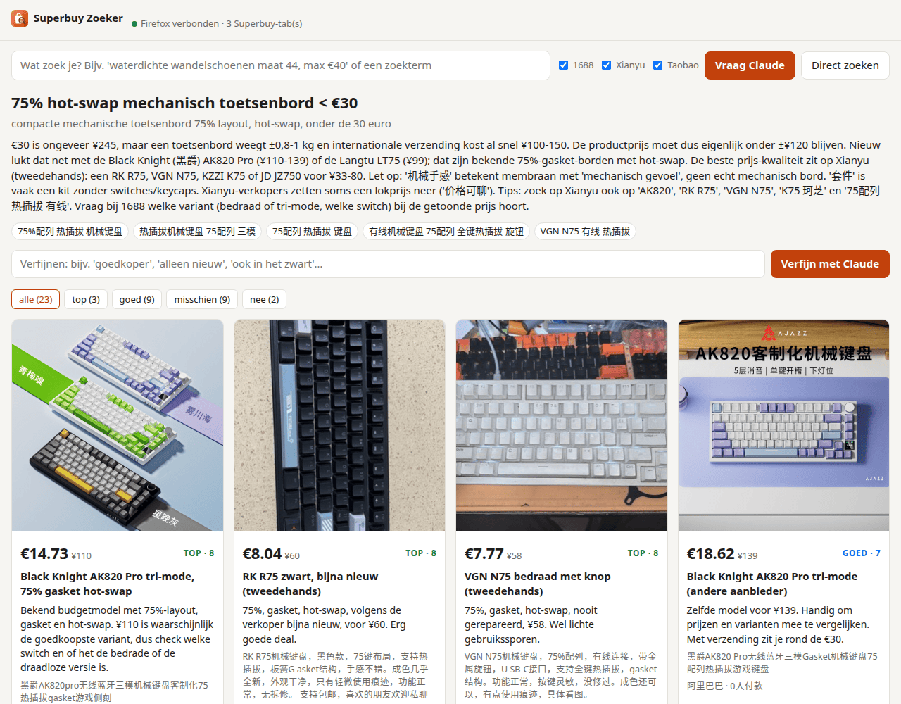

# Superbuy Zoeker

Better search on [Superbuy](https://www.superbuy.com) (Taobao, 1688, Xianyu), with Claude as your
shopping assistant.

On Superbuy you search with English keywords that get machine-translated to Chinese, and you get
results with Google-translated titles. Finding what you actually want is mostly guesswork. Here Claude
turns your wish into proper Chinese search terms (seller jargon, synonyms, model numbers), searches
several platforms, **judges the original Chinese titles** and shows a curated selection. Each item
gets a verdict and notes: bait prices, wholesale minimums, second-hand items, shipping weight.



> The interface and Claude's notes are in Dutch. To get another language, change `ASK_PROMPT` in
> `src/superbuy_search/bridge.py` and the labels in `static/index.html`.

## How it works

```
 web page / Claude Code ──▶ bridge (127.0.0.1:8765) ◀──long-poll── Firefox extension
                                                                      │
                                                     fetch inside your own superbuy.com tab
```

- **Firefox extension:** runs Superbuy's own search API inside a superbuy.com tab in *your*
  Firefox, with your login and cookies. You solve Cloudflare and hCaptcha checks yourself, like
  normal browsing. A toolbar button opens the search page.
- **Bridge:** a small local server (Python/Starlette), listening on `127.0.0.1` only. It queues
  requests for the extension and spaces them out so you stay under Superbuy's rate limit (with a
  back-off when the limit is hit). It also serves the search page.
- **Web page:** http://127.0.0.1:8765
  - *Direct zoeken* shows raw results from the selected platforms, without Claude.
  - *Vraag Claude* starts a headless `claude -p` that can only use the Superbuy tools. You see live
    which search terms it tries, and the curated selection appears when it is done. You can refine
    a selection afterwards ("cheaper", "only new", ...).
- **MCP server:** the same tools (`search`, `details`, `publish`, ...) inside an interactive
  Claude Code session.

Everything runs on your own computer, with your own Superbuy account. Nothing goes through a third
party, apart from Superbuy itself and, for *Vraag Claude*, Anthropic.

## Requirements

- Firefox 142 or newer
- [uv](https://docs.astral.sh/uv/) (installs Python and the dependencies for you)
- For *Vraag Claude* and the MCP tools:
  [Claude Code](https://docs.claude.com/en/docs/claude-code), logged in. Direct search works without it.
- A Superbuy account, logged in in Firefox

## Installation

```sh
git clone https://github.com/MichielBruijn/superbuy-search
cd superbuy-search
uv sync
uv run superbuy-bridge        # leave this running; open http://127.0.0.1:8765
```

Install the extension: download the signed `.xpi` from
[Releases](https://github.com/MichielBruijn/superbuy-search/releases), then in Firefox go to
`about:addons`, click the gear icon and choose *Install Add-on From File…*. Open superbuy.com once
and log in. The page header should now say *Firefox verbonden*.

**Run the bridge automatically (Linux, systemd):**

```sh
cp systemd/superbuy-bridge.service ~/.config/systemd/user/
# adjust the path in ExecStart if you cloned somewhere other than ~/Projects/superbuy-search
systemctl --user enable --now superbuy-bridge
```

**Use it from your phone (optional):** the bridge keeps running on your computer. On the phone you
open the search page and, ideally, install the extension in Firefox for Android too, so searches and
captchas happen on the phone. First give the bridge a token:

```sh
mkdir -p ~/.config/systemd/user/superbuy-bridge.service.d
printf '[Service]\nEnvironment=SUPERBUY_REMOTE_TOKEN=%s\n' "$(openssl rand -hex 16)" \
  > ~/.config/systemd/user/superbuy-bridge.service.d/remote.conf
systemctl --user daemon-reload && systemctl --user restart superbuy-bridge
```

Your link is then `http://<computer>:8765/login?token=<token>`.

- **Page only:** open the link once on the phone. It sets a cookie; after that you can use *Add to
  home screen*. The searches then run in Firefox on the computer, and if Firefox isn't running the
  bridge starts it.
- **Phone does the searching:** in Firefox for Android, open *Settings → About Firefox* and tap the
  logo 5 times. Then use *Install add-on from file* with the `.xpi`. Paste the link into the add-on's
  settings and tap *Opslaan en testen*. Log in to superbuy.com on the phone. Searches started from the
  phone now go through the phone's Firefox, so captchas show up there. If the phone isn't connected,
  the computer's Firefox takes over.

Security: only private IPv4 addresses (LAN, VPN) get in, and only with the token, sent as a cookie or
a header. Without a token the bridge listens on 127.0.0.1 only.

**Claude Code MCP (optional):**

```sh
claude mcp add -s user superbuy -- uv run --project /path/to/superbuy-search superbuy-mcp
```

## Notes

- **Rate limit:** Superbuy limits its search API per account. If you go over it you get
  "Request too often" and a captcha on the site. The bridge waits 4 to 7 seconds between searches
  and backs off when it hits the limit. Claude does at most 8 searches per question. Solve the
  captcha in Firefox if one appears.
- **Shipping restrictions:** Superbuy flags items as *Batteried Items*, *Sensitive Items* or
  *irregular shape*. Those can only go with selected carriers, which costs more. The flag depends on
  the category the seller picked, so the same product is often unflagged at another seller. It only
  shows up in the product details. Cards get a badge, or a *verzendcheck* button (one detail call),
  and *verberg verzendbeperkt* hides flagged items. With *geen batterij/sensitive* checked, Claude
  checks its candidates and looks for unflagged alternatives. Results are cached, including products
  you open yourself on Superbuy.
- **Taobao** search on Superbuy uses an affiliate index (ALIMAMA) with a lot of noise. **1688** and
  **Xianyu** use Superbuy's own search and give much more relevant results.
- *Vraag Claude* uses your Claude subscription. Set `SUPERBUY_CLAUDE_MODEL` (for example `sonnet`)
  in the service to pick a model.
- Data (sessions, item cache, API captures) is stored in `~/.local/share/superbuy-search/`.
- To build the extension yourself: `scripts/sign-extension.sh` signs it as unlisted through AMO,
  with your own API keys. For quick testing, load `extension/manifest.json` via
  `about:debugging` → *Load Temporary Add-on…*.

This is an unofficial tool, not affiliated with Superbuy. Use it at your own risk and within
Superbuy's terms.

## License

MIT
